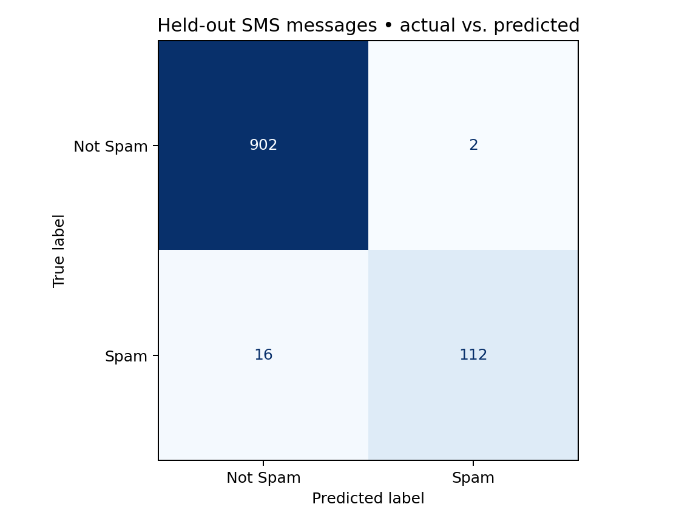

# Message Check — Spam Message Detector

A beginner-friendly Streamlit app that classifies English text messages as **Spam** or **Not Spam** using a saved TF-IDF + Multinomial Naive Bayes pipeline. Includes a trained model, source dataset, training script, evaluation results, and interface tests.

## Run locally

Use Python 3.12 (the version used for validation). Open a terminal in this folder:

```sh
python3 -m venv .venv
source .venv/bin/activate
python -m pip install -r requirements.txt
python -m streamlit run app.py --browser.gatherUsageStats false
```

On Windows, activate with `.venv\Scripts\activate` instead. Open the local address printed by Streamlit, usually http://localhost:8501. The saved model is included; training and internet access are not required to make predictions after setup. Only load model files you trust: joblib files can execute code when loaded.

Type or paste a message, then press **Check Message**. Four example buttons fill the text box. Try “Congratulations! You have won a FREE cash prize. Call now to claim your reward!” or “Hey, are we still meeting for dinner at 7? I'll book a table.” Edit and check again. Empty or whitespace-only input produces a helpful prompt.

## Train and evaluate

```sh
python train.py
# Optional: use a different local copy of the same tab-separated dataset
python train.py --data /path/to/SMSSpamCollection
python -m unittest -v test_app.py
```

If the data file is missing, training downloads the official archive over HTTPS. For an offline setup, retain the included `data/` folder. Training overwrites the saved pipeline and evaluation files. The app caches its model: restart Streamlit after retraining.

Dataset: [UCI SMS Spam Collection](https://archive.ics.uci.edu/dataset/228/sms+spam+collection), Almeida, T. and Hidalgo, J. (2011), DOI: 10.24432/C5CC84. UCI lists the dataset under CC BY 4.0. The original dataset notes are preserved in `data/UCI-readme.txt`.

## Method and actual results

The downloaded file has 5,574 records. Normalizing case and whitespace for deduplication removes 415 repeats, leaving 5,159 messages. If an equivalent message has conflicting labels, all copies are excluded (none found in this run). Original message text is retained for modeling.

An 80/20 stratified split with seed 42 gives 4,127 training messages and 1,032 test messages. TF-IDF uses words and word pairs with sublinear term frequency. Multinomial Naive Bayes uses alpha 0.1. Settings were fixed before test evaluation; the test set was not used to tune them. The vectorizer is fitted only on training data and saved with the classifier in `model/spam_pipeline.joblib`.

| Held-out spam metric | Result |
| --- | ---: |
| Precision | 0.9825 |
| Recall | 0.8750 |
| F1 | 0.9256 |
| Target F1 ≥ 0.85 | Met |

Overall accuracy: 0.9826. Test support: 904 Not Spam, 128 Spam.

| Actual / Predicted | Not Spam | Spam |
| --- | ---: | ---: |
| Not Spam | 902 | 2 |
| Spam | 16 | 112 |



Machine-readable results and dataset checksum are in `evaluation/metrics.json`; the full per-class report is in `evaluation/report.txt`. A local 100-run check measured mean prediction time below 1 ms and model load time around 0.52 seconds (`evaluation/timing.json`). This measures model execution, excluding browser rendering and server startup; speed varies by computer.

The automated interface tests cover empty/whitespace input, all examples, message edits clearing old results, repeated predictions, and unusual text including emoji and long input.

## Limits and privacy

This is an educational English SMS classifier. Historical SMS patterns may differ from today's spam; unfamiliar words, other languages, and very short messages can produce unreliable results. It missed 16 spam messages in the held-out set. “Not Spam” is not a safety guarantee. It does not scan accounts or block messages.

Submitted text is processed in memory and is not written to files or a database, cached, or used for training. The app keeps the current text in the active Streamlit session. Run locally for local processing; if hosted elsewhere, input is sent to that host. Streamlit usage telemetry can be disabled with the launch flag above.

Future work: compare classifiers, add more languages, and explain which words influence predictions.
